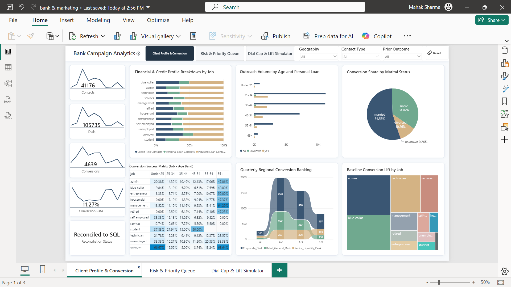
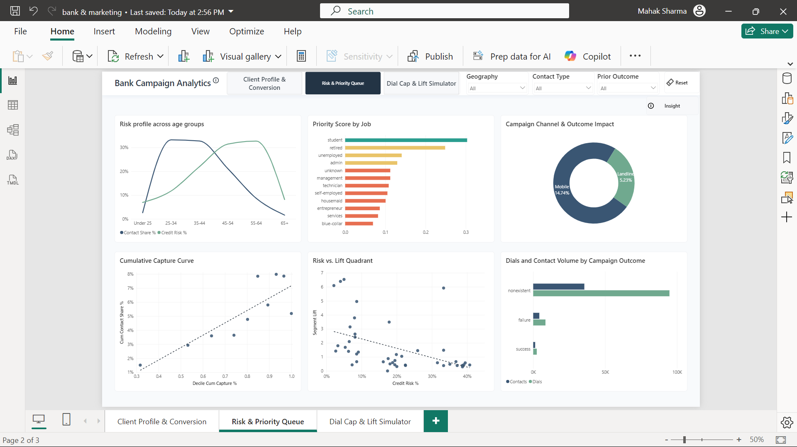
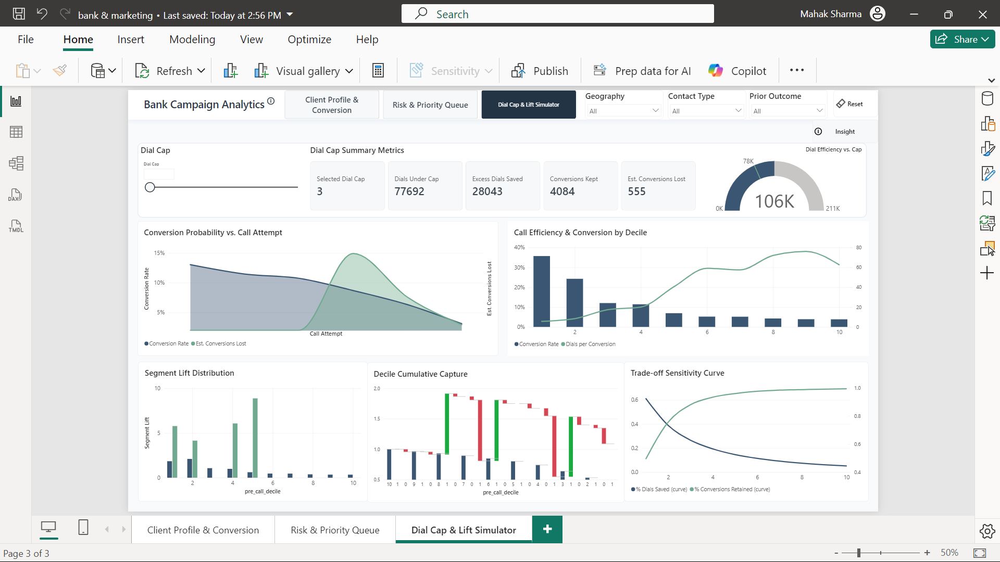

# Bank Campaign Analytics

A SQL, Python and Power BI project on a bank's phone marketing campaign for term deposits. It looks at which clients subscribe, how results change with the number of calls, and what happens if calls per client are capped.

## Data
- Source: [UCI Bank Marketing dataset](https://archive.ics.uci.edu/dataset/222/bank+marketing), file `bank-additional-full.csv`. This is public data, not a real bank's internal records.
- 41,188 raw rows. After removing 12 exact duplicates: 41,176 contacts, 4,639 subscriptions (11.27%).
- The CSV is not stored in this repo. Download it from the link above.

## Questions
1. Which client groups subscribe most often?
2. How does the subscription rate change as calls increase?
3. What would a cap on calls per client save, and what would it cost?
4. Which client segments should be called first?

## Tools Used
- PostgreSQL 17
- Python (`pandas`, `SQLAlchemy`)
- Power BI (DAX, RLS)

## Project Structure

- `01_prep_and_load.py` – Cleans the raw CSV, calculates pre-call scores/deciles, and loads data into Postgres.
- `02_star_schema_and_analysis.sql` – Sets up the star schema (`dim_client`, `dim_campaign`, `dim_calendar`, `dim_economic`, `fact_calls`) and RLS tables.
- `03_campaign_targeting_queries.sql` – 7 SQL queries for validating client profiles, risk, priority queues, and dial cap metrics.
- `04_Power_BI_DAX_Measures.txt` – DAX measures used for the Power BI dashboard, dial simulator, and row-level security rules.

## Quick Insights

- Stopping at 3 dials saves ~28k calls (uses 77,692 of 105,735) while hanging onto 4,084 of the 4,639 total conversions (555 came on call #3).
- Conversion starts at 5.58% on call 1, drops to 4.83% by call 6, and bottoms out around 4.35% past 10 attempts.
- Students and retirees scored highest on the priority queue, with the under-25 and 65+ age groups showing the lowest overall credit risk.
- The '25–34' age band accounts for the highest contact share (~32%), but credit risk peaks in the '55–64' age group.

## Dashboard

## How to run
1. Download the CSV from the UCI link.
2. Create a PostgreSQL database.
3. Copy `.env.example` to `.env` and fill in your database details.
4. `pip install -r requirements.txt`
5. `python 01_prep_and_load.py bank-additional-full.csv`
6. Run `02_star_schema_and_analysis.sql`, then `03_campaign_targeting_queries.sql`.
7. Use `04_Power_BI_DAX_Measures.txt` with the Power BI file.

## Limitations
- The "desk" regions (Corporate, Senior Liquidity, Retail) are assigned from job titles. They are not in the original data. The agent emails in the security table are demo values.
- The pre-call score is a smoothed segment conversion rate, not a prediction model. Call duration is left out of it because it is only known after the call.
- Python smooths with a weight of 20 over four columns. The SQL queries and DAX use 50 over different columns, so the two scores differ.
- The dial cap results are counted on past data. They show what would have been kept or lost, not a guaranteed outcome.
